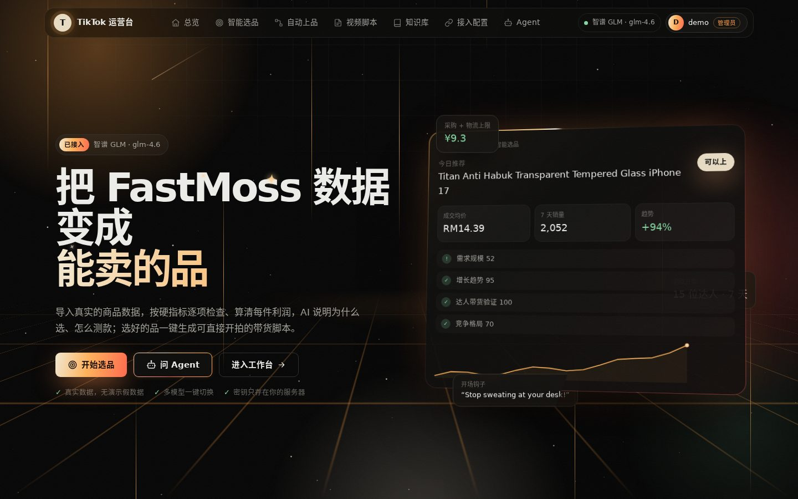
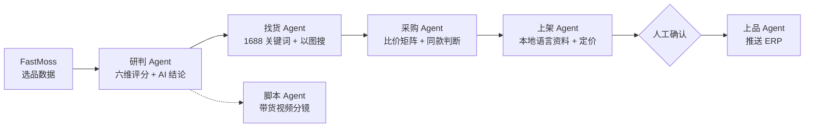
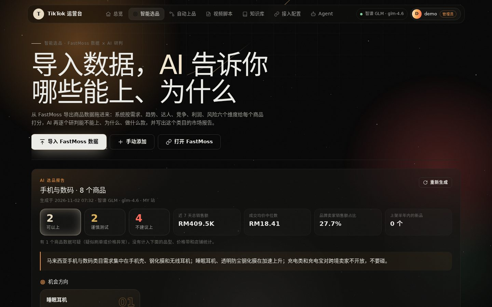
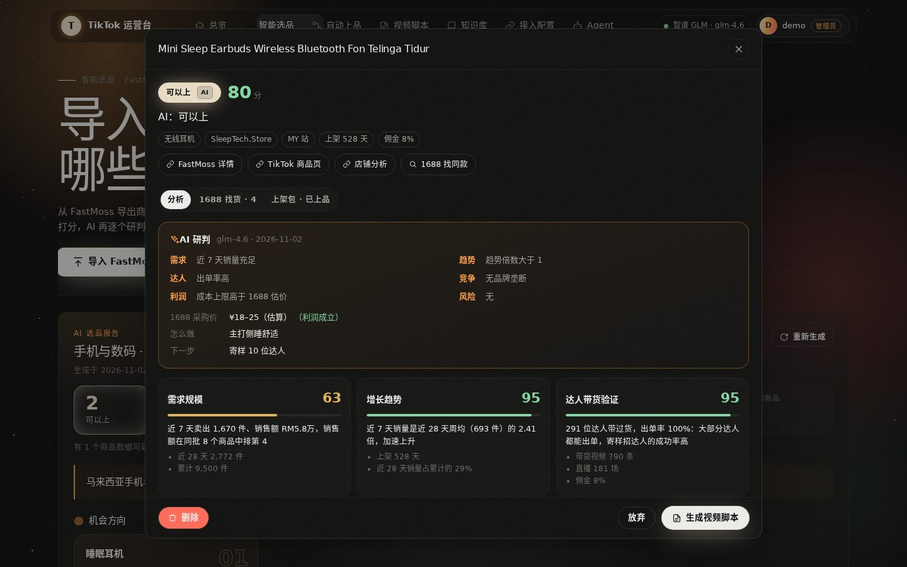
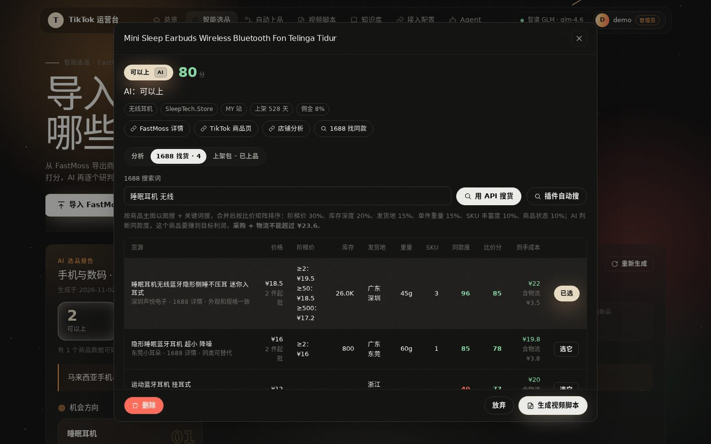
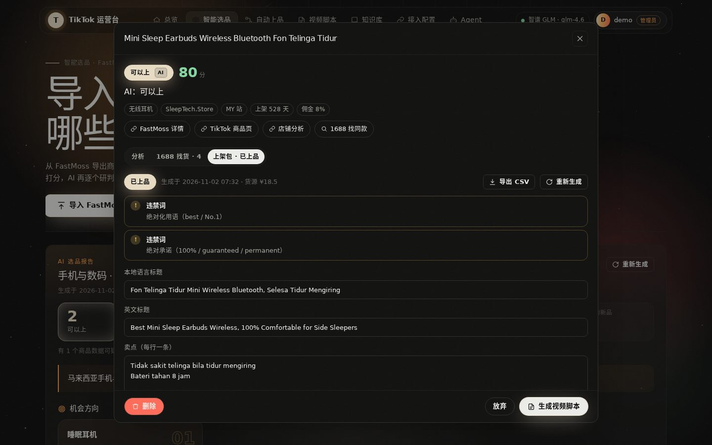
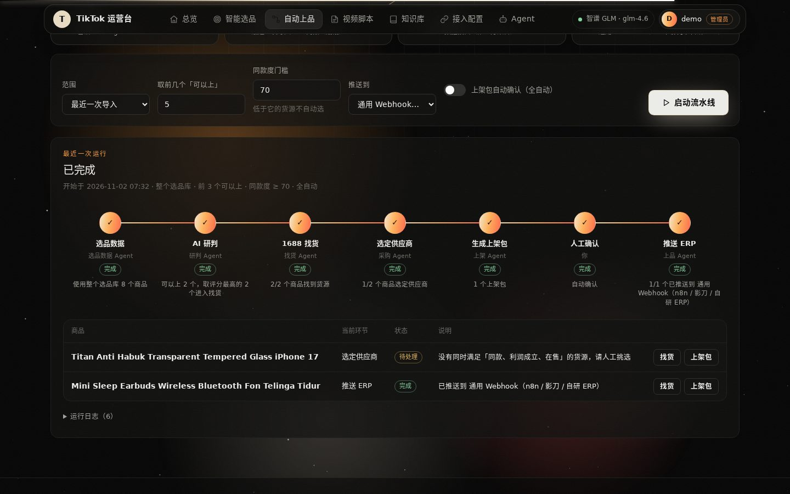
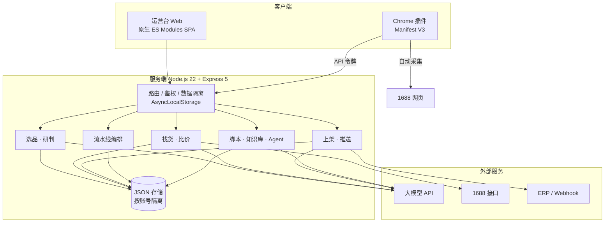

<div align="center">



**AI 驱动的 TikTok 跨境电商全链路运营系统**

选品研判 → 1688 找货比价 → AI 上架 → ERP 推送 → 测款复盘，一直管到「这个品该加码还是该止损」；再加上爆款拆解、方法论驱动的脚本和 AI 成片

<a href="https://tkagent.hyff.cc.cd"></a>


[](https://github.com/serjofolio/tiktok-ai-ops/actions/workflows/test.yml)




<sub>注册后在总览点「载入示例工作区」，不接模型也能看完整流程（示例数据是虚构的，页面会标明，可一键清除）；每个账号的数据和模型密钥相互隔离。AI 功能需在「接入配置」填入你自己的大模型密钥。</sub>

</div>

---

## 为什么做这个

做 TikTok 东南亚跨境，一个商品从「看到数据」到「挂上店铺」要经过：数据工具里筛品、算利润、查侵权，在 1688 上反复搜索比价，写马来语 / 泰语上架资料，录进 ERP，再写带货视频脚本。这些工作通常要选品、采购、运营、内容 **4～5 个岗位、十几个人** 配合完成，大部分时间都花在重复判断和搬运上。

**TikTok 运营台把这条链路交给 AI Agent 接力完成**：人只在关键节点做决定，其他交给系统。



## 核心能力

| | 能力 | 说明 |
|---|---|---|
| 🎯 | **多维度智能选品** | 导入 FastMoss 导出数据，从需求规模、增长趋势、达人带货、竞争格局、利润空间、风险六个维度打分，给出「可以上 / 谨慎测试 / 不建议上」和理由 |
| 🧠 | **AI 研判报告** | 整批商品的市场概览、机会方向、品型地图、价格带分析；逐个商品给出能不能做、怎么做、下一步 |
| 🛡️ | **硬性风险拦截** | 邀约类目、带电商品、品牌 / IP 侵权、疑似刷单数据自动识别；**规则优先，AI 不能把有硬伤的商品判成能上** |
| 💰 | **利润倒推** | 按站点平台费率、达人佣金、退货、广告费和汇率，算出单件净利和「采购 + 物流最多能花多少」 |
| 🔍 | **1688 找货比价** | AI 提炼中文搜索词，关键词 + 主图以图搜，比价矩阵排序，AI 判断同款度，标出利润是否成立 |
| ✍️ | **AI 上架包** | 本地语言 + 英文标题、5 条卖点、描述、搜索词、SKU、按目标利润定价；自动检查违禁词 |
| 🔗 | **ERP 一键推送** | 妙手 ERP、通用 Webhook（n8n / 影刀 / 自研 ERP）、CSV 导出；店小秘、马帮等预留接入 |
| ⚙️ | **多 Agent 流水线** | 7 个环节自动接力，每一步有状态和日志；缺接口时停下提示，可选全自动 |
| 🧩 | **浏览器插件** | 没有 1688 官方接口也能跑：插件自动搜索、上传主图以图搜、采集货源、补全详情 |
| 📈 | **增长榜** | 按类目选出近 N 天销量和 GMV 增长最快的商品；逐日数据或两次导入算实测，只有一次数据的明确标为估算 |
| 🗂️ | **选品库筛选** | 按导入日期、批次、分类、品型、站点、价格、销量筛选，批量研判、标记、删除；旧导出文件可补历史 |
| 🔌 | **FastMoss 开放接口** | 官方接口按类目拉商品和逐日销量，不占网页导出次数；插件也可以发送当前页（测试版） |
| 📖 | **爆款方法论** | 基于官方规则、投放数据、论文、案例和 550 条公开视频样本的总结，每条标注证据等级和来源，可在系统内查看 |
| 🎬 | **带货视频脚本** | 21 种风格、14 种钩子、AI 挖痛点，一次生成多条不同开头；程序按规则自检；可导出字幕 |
| 🎞️ | **商品的爆款视频** | 粘贴 TikTok 视频链接，直接看到播放、点赞、评论、收藏、分享和互动率；视频存到自己的服务器，可播放、保存、一键送去拆解 |
| 🔬 | **爆款视频拆解** | 上传视频或粘贴 TikTok 链接：ffmpeg 测量切镜节奏，语音转写，视觉模型逐帧描述，生成逐段报告和可复用模板，再学习结构写脚本 |
| 🎥 | **脚本直接生成视频** | 接入 Seedance、可灵、通义万相、海螺、中转站或自定义接口；分镜生成并合并，或一次生成整条；视频存到本地可下载 |
| 🎬 | **AI 出片创作台** | 不用等脚本：自己写分镜就能出片，中文描述一键改写成模型听得懂的英文提示词；随时插入、移动、删除镜头；每个镜头可以上传或用图片模型生成首帧；一次出 1–4 个版本；脚本导进来改完可以存回去 |
| 🎞️ | **批量出片** | 上传商品图或实拍视频，一次做十几条不同开头的视频：程序分配钩子和场景，先出几毛钱一张的关键帧，看图模型对照真实商品打分，人确认后才为合格的付视频钱，成片再抽帧复检；按单价实时估算花费，可设预算上限 |
| ⚔️ | **测款作战室** | 按真实成本算保本 CPA 和止损线，每天录数据，程序判断加码、继续、优化还是止损，并用保本反推转化率指出钱漏在哪；素材榜评出最能卖的开头，学它再写新脚本 |
| ✅ | **今日行动** | 打开总览就知道今天先做什么：该停的、该加预算的、该确认的、增长榜上还没开打的品 |
| 🧪 | **示例工作区** | 一键载入标明「示例」的虚构数据，一键清除，不影响真实数据 |
| 📚 | **知识库 + Agent** | 上传运营资料切片检索，对话式 Agent 引用来源回答 |
| 🧭 | **使用指南** | 每个页面右上角的「?」打开这一页的用法（做什么、怎么一步步用、注意什么），「使用指南」页汇总全部功能和推荐流程 |
| 🈶 | **商品名中英双语** | 打开选品库时后台用大模型把外文标题翻成中文短名，页面同时显示中文名和原标题；商品选择器可以按中文、英文或类目搜索 |
| 👥 | **多账号与数据隔离** | 管理员 + 注册用户，商品、知识库、模型密钥按账号完全隔离，适合对外演示 |

## 工程亮点

| 难点 | 做法 |
|---|---|
| **AI 不可靠** | 规则引擎先给出六维评分和硬性风险，AI 给出最终研判；只有硬伤（定邀、品牌 / IP、疑似刷单等）AI 不能推翻，页面会说明原因 |
| **文字模型会假装看过图** | 拆解视频前先发一张程序生成的已知图片，答对才算看得见；切镜次数、时长、语速由程序测量，不交给模型猜 |
| **视频任务又慢又花钱** | 任务 ID 持久化，服务重启后接着查询，不重复提交；提交前算好任务数和秒数；失败的片段可单独重试 |
| **上传文件不可信** | 按文件头判断格式，ffmpeg 只放行本地文件和常见视频格式，防止用播放列表读服务器文件；普通用户有存储上限 |
| **大模型输出被截断 / 超时** | 分批并发调用，残缺 JSON 自动修复，失败重试，任务状态持久化，可从中断处继续 |
| **多账号数据隔离** | 用 `AsyncLocalStorage` 在请求上下文里携带当前账号，存储层自动按账号读写，业务代码不用到处传用户 ID，也就不会漏传 |
| **没有 1688 官方接口** | Chrome MV3 插件自动完成搜索、以图搜、采集。商品卡片不依赖 class 名识别：从商品 ID 出发找「只包含这个 ID 的最大祖先节点」，1688 改版后仍然有效；识别失败时一键上报页面结构 |
| **1688 风控** | 模拟真实浏览节奏（随机间隔、平滑滚动、完整的指针事件），检测到人机验证立即暂停，之后 20 分钟内不再自动打开页面 |
| **插件后台被浏览器回收** | 任务状态存在 `chrome.storage.session`，按标签页登记；写入串行化，避免并发事件互相覆盖 |
| **安全** | 服务只监听本机端口，外网只能经 Cloudflare 隧道访问；普通用户填写的地址不能指向内网（逐跳检查跳转，连接时再校验解析结果）；令牌只存哈希 |
| **该加码还是该止损不能交给模型** | 决策由程序按账本计算，边界逐条有测试；少于 5 单不下结论，累计赚钱但最近变贵时不建议加预算；阈值是经验值，页面标明且可改 |
| **可验证** | 53 个 Playwright 端到端用例，在真实 Chromium 中加载插件跑完整流程；大模型、1688、ERP、FastMoss 接口和视频模型都由本地模拟服务提供，真实厂商接口按官方文档实现 |

---

## 功能详解

### 1. 智能选品：导入数据，AI 告诉你哪些能上、为什么



- **零配置导入**：拖入 FastMoss 导出的 Excel / CSV，自动识别全部 22 个字段，兼容 `RM` 等币种前缀和区间价格。
- **六维评分**：
  - **需求规模**：近 7 天销量、销售额排名。
  - **增长趋势**：动销倍数，即近 7 天销量 ÷ 28 天周均。
  - **达人带货**：达人数、出单率、视频与直播数。
  - **竞争格局**：品牌垄断度。
  - **利润空间**：实际成交均价，并倒推成本上限。
  - **风险**：侵权、类目、带电、数据异常。
- **AI 研判报告**：
  - 市场一句话总结、机会方向（建议售价、差异化打法、1688 搜索词）。
  - 品型地图、价格带分布、品牌集中度、新品占比。
  - 每个商品的 AI 结论和理由。
- **数据可信度**：销量远超同类但达人很少、销量来源不明等异常数据标记为「数据可疑」，不计入市场统计。
- **工程上的稳健性**：AI 分批研判、并发调用；模型输出被截断时自动修复 JSON，失败时拆半重试；服务重启后任务可以恢复。



### 2. 1688 找货：比价矩阵 + AI 同款判断



| 维度 | 权重 | 看什么 |
|---|---|---|
| 阶梯价 | 30% | 起批价、批量价 |
| 库存深度 | 20% | 能不能稳定供货 |
| 发货地 | 15% | 广东、浙江等产业带优先 |
| 单件重量 | 15% | 决定跨境物流成本 |
| SKU 丰富度 | 10% | 款式、颜色可选 |
| 商品状态 | 10% | 是否在售 |

- AI 判断每个货源与 TikTok 商品的同款度（0～100），**同款优先，价格再低不是同款也没用**。
- 到手成本 = 采购价 + 估算跨境物流，直接和成本上限比较，红绿标出利润是否成立。
- 选定供应商后，采购价和物流自动写回利润测算。

### 3. AI 上架包：本地化资料 + 违禁词检查



- 按站点生成本地语言（马来语 / 泰语 / 越南语…）和英文标题、5 条卖点、分段描述、搜索词、SKU。
- 按目标利润率倒推售价。
- 违禁词检查：
  - 绝对化用语（best / No.1）、绝对承诺（100% / guaranteed）。
  - 医疗功效、站外引流。
  - 品牌名误用：自动识别 `for iPhone` 这类兼容写法，不误报。
- 人工确认后才能推送，推送成功后商品自动进入「测款中」。

### 4. 自动上品流水线：多 Agent 接力



- 7 个环节：选品数据 → AI 研判 → 1688 找货 → 选定供应商 → 生成上架包 → 人工确认 → 推送 ERP。
- 运行前检查大模型、选品数据、1688 找货、ERP 四项是否就绪，缺什么、去哪补一目了然。
- 可配置范围（最近一次导入 / 整个选品库）、取前 N 个「可以上」、同款度门槛、推送目标；人工确认可改为全自动。
- 中断后可以从断点继续。

### 5. 爆款方法论、脚本与成片

- **爆款方法论**：系统内可查，每条标注来自官方、投放数据、论文、案例还是样本，并写明研究的局限。
- **写脚本**：商品可以来自选品库，也可以只传商品图片或视频（看图模型认出商品名、外观和卖点，用户可改），素材跟着脚本走，生成视频时当商品参考图；21 种风格、14 种钩子，AI 从评论和场景里挖痛点；一次生成多条不同开头，程序检查寒暄开头、违禁词（含马来语、越南语、泰语）、提及大牌、口播念不完等问题。
- **爆款拆解**：上传视频后得到关键爆点、前 3 秒逐帧、逐段分镜、节奏、痛点、转化设计、可复用模板和不能照搬的内容，然后学结构写自己的脚本。
- **生成视频**：在「接入配置 → 视频模型」接入后，脚本可直接生成视频，保存到视频库。按 TikTok Shop 的 AI 内容规则提醒标注，并可跳过商品镜头、改用实拍。
- **AI 出片创作台**：独立于脚本的出片工具。写分镜（中文也行，「优化提示词」按提示词规则改写成英文），每个镜头单独设时长、口播、首帧；商品参考图交给支持参考图的模型（Seedance、中转站）；逐镜头生成再合并，或整条一次生成多镜头；一次出几个版本挑好的。脚本详情里点「改分镜再出片」把脚本导进来改，改完「存成脚本」会重新自检。
- **批量出片**：视频模型按秒收费、出废片也照扣，所以先用商品图生成关键帧（视频第一帧）。每条的钩子和场景由程序分配，保证一批里彼此不同；看图模型把关键帧和真实商品拼在一起打分（像不像 60%、抓不抓眼 40%），商品不像的默认不做。确认后只把勾选的关键帧做成视频，成片抽开头、中间、结尾三帧再复检。提示词按「主体 + 一到两个简单动作 + 一种镜头运动 + 光线」来写，程序在末尾固定加上「商品不变形、不新增物体、不写字」。没有商品图也能做，画面以人和场景为主。
  - 参考成品网站（Creatify、Higgsfield、Topview、Pippit）补上的功能：7 种视频格式（UGC 口播测评、开箱、上身试戴、产品展示、痛点解决、送礼、自动混合）；上传一张模特照片让整批视频用同一个人；选一条拆解过的爆款，学它的钩子、节奏和结构；8 秒以上一次生成 2–3 个镜头；每条视频导出 SRT 字幕，剪映 / CapCut 直接导入。
  - 和成品网站比：同样用 Seedance 2.0 出 5 秒 720p，成品网站按套餐折算每条约 ¥14–20，接自己的中转站每条约 ¥3–5（2026-11 的公开价格，以账单为准）；差价买的是工作流，这部分系统里已经有了。

### 6. 测款作战室：选中之后的事

- **一键备战**：AI 分析、找货、选供应商、上架包、3 条不同开头的脚本。只补缺的，不覆盖人工修改，不自动推送；有硬伤的商品要先确认。
- **单件账本**：售价扣平台费、退货、采购和物流，算出每单最多能花多少钱买流量；自投单和达人单分开算。
- **决策**：录入播放、点击、订单和花费后，给出加码、继续、优化或止损，并写明依据。数据目前手动录入，不能自动同步。
- **诊断**：不套行业均值，用「每次点击成本 ÷ 保本 CPA」算出保本需要的转化率。
- **素材榜**：按素材统计 CPA，至少 3 单才评赢家，可以学赢家再写新脚本。
- **作战书**：导出 Markdown，发给团队或留档。

### 7. 浏览器插件「运营台助手」：没有官方接口也能自动找货

1688 开放平台接口申请门槛高，妙手等 ERP 接口要审核。插件在你**自己已登录的浏览器**里完成采集：

- **自动关键词搜**：选好商品，插件打开 1688 搜索，像人一样浏览页面，采集结果卡片送回运营台。
- **自动以图搜**：插件把商品主图传进 1688「以图搜款」，自动点击「搜索」并采集结果。
- **自动补详情**：在后台依次打开排名靠前的详情页，补全阶梯价、库存、单件重量、发货地、SKU。
- **识别不依赖页面样式**：从详情链接、商品 ID 属性、埋点数据、页面内嵌数据多路识别，1688 改版也能工作；识别失败时自动把页面结构上报到运营台，便于快速修正。
- **防风控**：操作节奏随机，详情页间隔 8～15 秒，两次找货间隔至少 15 秒；弹出人机验证时暂停等你处理，之后 20 分钟内不再自动打开详情页。
- 插件和 n8n、影刀等外部程序统一用 API 令牌（`Authorization: Bearer tk_…`）调用 `/api/ext/*`。

### 8. 接入配置：多模型、多数据源、多 ERP


编辑页参考 CC Switch：Logo、名称和备注、官网、可显示的密钥和「获取 API Key」入口、请求地址（可预览完整 URL）、模型映射表（从上游拉模型列表，中转站还能读公开价格表自动填单价）、高级选项，以及和表单双向同步的原始 JSON。

| 类别 | 支持 |
|---|---|
| 大模型 | 智谱 GLM（按量 / 编码套餐 / Anthropic 协议）、DeepSeek、Kimi、通义千问、豆包、OpenAI、Claude、任意 OpenAI 兼容接口 |
| 视频 / 图片模型 | Seedance、可灵、通义万相、海螺、Seedream；new-api 一类中转站（`/v1/videos`、`/v1/images/generations`、对话接口出图）；自定义异步接口 |
| 1688 数据 | 1688 开放平台（官方签名调用）、第三方数据接口（关键词搜 / 以图搜 / 商品详情）、浏览器插件 |
| ERP | 妙手 ERP、通用 Webhook（HMAC 签名）、CSV 导出；店小秘、马帮、芒果店长、通途、领星、积加预留 |

---

## 系统架构



| 目录 | 内容 |
|---|---|
| `server/services/selection.js` | 选品规则：站点费率、品型识别、六维评分、风险标记 |
| `server/services/report.js` | AI 研判报告：分批、并发、截断修复、重试、断点恢复 |
| `server/services/sourcing.js` | 1688 找货：搜索词、比价矩阵、同款判断、到手成本 |
| `server/services/listing.js` | 上架包、违禁词、定价、推送 |
| `server/services/pipeline.js` | 多 Agent 流水线编排 |
| `server/connectors.js` | 数据源 / ERP 连接器、签名、防内网访问 |
| `extension/` | 浏览器插件：任务调度、页面识别、自动操作 |
| `tests/` | Playwright 端到端测试 + 本地模拟上游（大模型 / 1688 / Webhook） |

## 安全设计

- **账号隔离**：商品、脚本、知识库、模型密钥、连接器全部按账号隔离；第一个注册的账号自动成为管理员。管理员可以开关注册、停用账号、重置密码、删除账号（连同数据）。
- **密码与会话**：scrypt 加盐哈希；HttpOnly 会话 Cookie；同一 IP 连续输错 10 次锁定 15 分钟；跨站请求来源校验。
- **API 令牌**：只显示一次，服务端只存哈希，可随时撤销。
- **防内网访问**：普通用户配置的接口地址不能指向服务器内网。
- **部署隔离**：服务只监听 `127.0.0.1`，外网只能经 Cloudflare 隧道和域名访问，IP 直连一律 403。
- **密钥不入库**：隧道令牌、服务器地址只放在被 git 忽略的 `deploy/deploy.env`；每次推送由 CI 用 gitleaks 扫描全部提交历史，发现密钥即报红。

---

## 快速开始

### Windows 本机
安装 [Node.js 18+](https://nodejs.org/zh-cn/download)，双击 `start.bat`，浏览器打开 `http://localhost:3800`，注册第一个账号（自动成为管理员）。

### macOS / Linux
```bash
npm install
npm start          # http://localhost:3800
```

### 接入大模型（以智谱 GLM 为例）
「接入配置 → 添加供应商」选择预设即可：
- OpenAI 兼容（按量计费）：`https://open.bigmodel.cn/api/paas/v4`
- GLM 编码套餐：`https://open.bigmodel.cn/api/coding/paas/v4`
- Anthropic 协议：`https://open.bigmodel.cn/api/anthropic`（协议选 Anthropic，地址不要再加 /v1）

### 安装浏览器插件
1. 「接入配置 → 浏览器插件与 API 令牌」：下载插件压缩包，生成令牌。
2. 解压得到 `tiktok-ops-helper` 文件夹（里面直接是 `manifest.json`）。
3. Chrome 打开 `chrome://extensions`，开启开发者模式，点 **「加载未打包的扩展程序」**（不是「打包扩展程序」），选择该文件夹。
4. 点插件图标，粘贴令牌，「保存并测试连接」。

## 部署（Cloudflare 隧道）

```bash
# deploy/deploy.env（已被 git 忽略）
CF_TUNNEL_TOKEN=...
DEPLOY_SERVER=root@你的服务器IP
ADMIN_USER=admin

./deploy/deploy.sh                                              # macOS / Linux
powershell -ExecutionPolicy Bypass -File .\deploy\deploy.ps1    # Windows
```

一条命令完成：打包 → 上传 → 装好新版本依赖 → 备份旧数据 → 切换 → systemd 服务 → Cloudflare 隧道 → 健康检查（失败自动回滚）→ 开启自动更新。
- 数据目录 `/var/lib/tkagent`，备份在 `/var/backups/tkagent`，日志 `journalctl -u tkagent -f`。
- **自动更新**：部署时同时装上 `tkagent-update.timer`，服务器每 5 分钟查一次 GitHub，`main` 上测试和密钥扫描都通过的新提交自动下载安装。不需要在 GitHub 上存服务器地址或密钥。新版本先在旁边装好依赖再切换，启动失败自动换回旧版本，换版本前照常备份数据。日志 `journalctl -u tkagent-update`，关闭 `systemctl disable --now tkagent-update.timer`（或在 deploy.env 写 `AUTO_UPDATE=0`）。
- 忘记管理员密码：停止服务后执行 `node server/cli.js admin <用户名> [新密码]`；`node server/cli.js users` 列出所有账号。

## 测试

```bash
npm install && npx playwright install chromium
npm test
```

53 个 Playwright 端到端用例，覆盖注册登录与数据隔离、导入与评分、AI 研判报告、找货比价、上架包与违禁词、Webhook 签名推送、流水线，以及**在真实 Chromium 中加载插件**完成自动关键词搜、自动以图搜、采集新版 1688 卡片、补详情的全过程。大模型、1688、ERP 由本地模拟服务提供，测试走真实调用链路，结果稳定可重复。

## 路线图

- [x] 多维度选品 + AI 研判报告
- [x] 1688 找货比价 + AI 同款判断
- [x] AI 上架包 + 违禁词检查 + Webhook / ERP 推送
- [x] 多 Agent 自动上品流水线
- [x] 浏览器插件自动关键词搜 / 以图搜 / 补详情
- [ ] 妙手 ERP 官方接口审核通过后完成真实上品联调
- [x] FastMoss 开放接口拉取商品和逐日销量（已按官方文档实现，待真实密钥验证）
- [x] 爆款视频拆解、脚本生成视频（视频模型已按官方文档实现，待真实密钥验证）
- [x] 批量出片：先出关键帧质检再出视频，中转站模型列表和价格表（待真实密钥验证）
- [ ] 上架后数据回流：跟踪测款销量，自动建议加推或下架
- [ ] 团队协作：商品分配与审核流

## 版权声明

© 2025–2026 serjofolio。本仓库用于作品展示与技术交流，未授权任何开源许可证；未经作者书面许可，不得复制、修改或用于商业用途。
